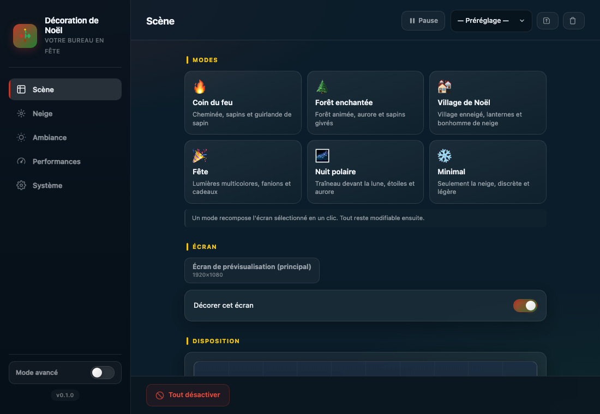
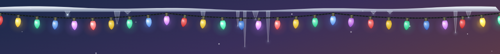
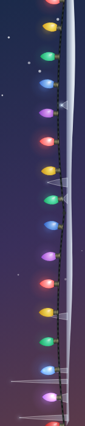

# 🎄 Décoration de Noël

Application de bureau **gratuite et open source** (macOS, Windows, Linux) qui décore votre ordinateur pour Noël :
neige animée, sapins, guirlandes, cheminée en briques, aurore boréale, et décoration du Dock ou de la barre des
tâches. **Aucune donnée collectée, aucune connexion requise.**


## Installation

Téléchargez l'installateur de votre système dans la page [Releases](../../releases) :

| Système | Fichier | Installation |
|---|---|---|
| macOS (Apple Silicon / Intel) | `.dmg` | Ouvrez le `.dmg`, glissez l'app dans *Applications* |
| Windows | `.exe` (NSIS) ou `.msi` | Lancez l'installateur (par utilisateur, sans droits administrateur) |
| Linux | `.deb`, `.rpm`, `.AppImage` | `sudo apt install ./fichier.deb`, ou lancez l'AppImage |

> **macOS : première ouverture.** L'application n'est pas signée par un compte développeur Apple. Au premier
> lancement, faites un clic droit sur l'app → *Ouvrir* → *Ouvrir*. Si macOS la déclare « endommagée » :
> `xattr -cr "/Applications/Décoration de Noël.app"`.
>
> **Windows : SmartScreen.** Même principe : *Informations complémentaires* → *Exécuter quand même*.

Au premier lancement, un **assistant** vous fait choisir l'ambiance, la quantité de neige, le Dock et le démarrage
automatique (relançable depuis *Système → Relancer l'assistant*).

L'application vit dans la **zone de notification** (barre des menus sur macOS) : fermer la fenêtre de réglages ne
l'arrête pas. Utilisez l'icône pour mettre en pause, rouvrir les réglages ou *Quitter*.

## Fonctionnalités

- **Scène par écran** : sapins, cheminées (bas de Noël, bougies, guirlande), bonhommes de neige, cadeaux, couronnes,
  glissés à la souris dans une carte de disposition. Six **modes** en un clic (Coin du feu, Forêt enchantée,
  Village de Noël, Fête, Nuit polaire, Minimal).
- **Neige** : densité, vent, accumulation au sol, flocons doux ou cristaux, scintillement.
- **Guirlande du haut** : cinq styles (ampoules rétro, branches de sapin, rideau lumineux, guirlande scintillante, fanions) et
  animations de lumières (scintillement, étincelles, poursuite, vague, pulsation…).
- **Fond animé** : aurore boréale, étoiles, ou arrière-plan personnalisé.
- **Dock / barre des tâches** : guirlande, stalactites et neige sur la bande du système, sur tous les bords.
- **Thèmes et préréglages** : 8 thèmes de couleurs, palettes personnalisées, préréglages enregistrables,
  importables et exportables.
- **Performances** : profils *Silencieux*, *Équilibré*, *Qualité*, qualité adaptative, moteur WebGL pour les
  sapins avec repli Canvas 2D.
- **Multi-écrans**, **langue** (français, anglais, espagnol, allemand, italien), **démarrage automatique**,
  son d'ambiance optionnel.

### Devant ou derrière les fenêtres

Deux réglages indépendants (*Système*) :

- **Emplacement de la décoration** : *Fond d'écran* (derrière vos fenêtres, comme un fond animé) ou *Par-dessus
  tout* (devant, sans jamais intercepter les clics).
- **Position de la bande du Dock** : *Derrière les fenêtres* (par défaut) ou *Par-dessus tout*.



| | |
|---|---|
|  | Bande du Dock / de la barre des tâches (bord bas). |
|  | Le même rendu pour un Dock à gauche. |

## Limites connues

- **macOS** : le Dock est dessiné au-dessus des fenêtres ordinaires. La décoration déborde donc de quelques pixels
  sur le bureau au lieu de recouvrir le Dock ; en mode « derrière les fenêtres » elle peut être en partie masquée.
- **macOS avec Dock masqué automatiquement** : aucune bande n'est détectable, rien n'est dessiné (les réglages le
  signalent).
- **Linux** : le placement derrière les fenêtres et la transparence dépendent du gestionnaire de fenêtres
  (testé principalement sous X11).
- Les interfaces anglaise, espagnole, allemande et italienne affichent encore le texte français pour les chaînes
  non traduites (`src/i18n/`).

## Développement

Prérequis : Node.js 18+, la chaîne [Rust](https://rustup.rs) et les
[prérequis Tauri v2](https://tauri.app/start/prerequisites/) de votre système.

```bash
npm install
npm run dev         # lance l'application (Tauri) avec rechargement
npm run serve:ui    # sert seulement l'interface sur http://localhost:4173 (sans Tauri)
npm test            # tests Playwright (interface, overlay, dock, rendu, perf)
npm run build       # installateurs dans src-tauri/target/release/bundle/
```

Les pages `settings`, `overlay` et `dock` sont du HTML/CSS/JS sans bundler. Tout appel au système passe par
`src/shared/bridge.js`, qui retombe sur `localStorage` hors Tauri : c'est ce qui les rend testables comme de
simples pages web.

```
src/settings   fenêtre de réglages          src/engine    moteur WebGL2 (sapins)
src/overlay    scène plein écran (Canvas)   src/layers    sapin 3D, aurore
src/dock       bande Dock / barre tâches    src/shared    réglages, scène, pont Tauri
src/i18n       traductions                  themes/       thèmes JSON (schemaVersion 1)
src-tauri      cœur Rust : fenêtres, tray, réglages, son, détection du Dock
```

Voir [`docs/ARCHITECTURE.md`](docs/ARCHITECTURE.md) pour les choix techniques (Tauri plutôt qu'Electron, détection
du Dock par système) et [`docs/IMPROVEMENTS.md`](docs/IMPROVEMENTS.md) pour l'historique des améliorations.

### Tests

`npm test` lance Playwright (projet `chromium` pour l'interface, projet `chromium-gl` pour le moteur WebGL). Les images de
référence sont dans `tests/screenshots/` ; après un changement visuel volontaire :
`npm run test:update-baselines`.

### Publier une version

Le workflow `.github/workflows/release.yml` construit les installateurs macOS, Windows et Linux et les joint à une
Release GitHub quand on pousse un tag `v*` (`git tag v0.1.0 && git push --tags`).

## Contribuer

Issues et PR bienvenues : ajoutez vos thèmes dans `themes/`, lancez `npm test` avant toute PR, et gardez
`src/settings`, `src/overlay` et `src/dock` libres d'API Tauri en dehors de `src/shared/bridge.js`.

## Licence

MIT — voir [`LICENSE`](LICENSE).
